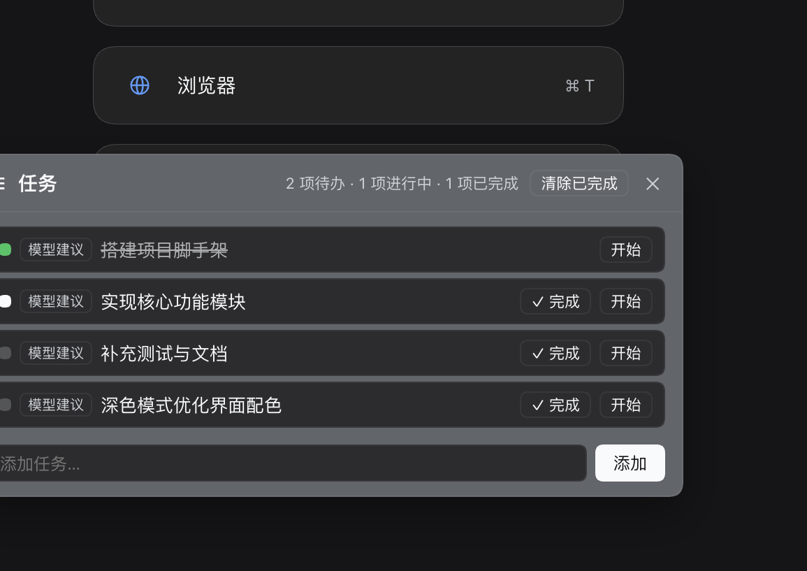

# dsh-task-manager

[](https://dsh-plugin.org/plugins/caipanjin/dsh-task-manager)

在 DeepSeek Harness 的聊天里管理任务：模型会提议任务，你也可以自己添加（甚至直接框选对话里的文字变成任务），点一下就能把某个任务交给模型开始执行。

一个无依赖的小插件，为 Harness 提供一个**悬浮任务面板**。任务可以来自**模型本身**（比如它给出一个实施顺序建议），也可以来自**你自己**（在面板里手动输入，或在对话里选中一段文字点「+ 添加为任务」）。每条任务都会标注来源——**模型建议** 还是 **手动添加**——让你随时清楚它的出处。当模型判断某个任务已完成时，面板不会悄悄把任务标为完成，而是弹出一个**批量确认**提示，由你来拍板。选中某条任务点「开始」，会先弹一条确认，确认后才把「开始执行这个任务：<标题>」发送到对话框，交给模型执行。



## 功能特性

- **两种任务来源** —— 模型建议（通过 `task_write` 工具）与用户手动添加（在面板输入），每行带来源徽标（**模型建议** / **手动添加**）。
- **一份共享的任务列表** —— 你在面板里的每一次操作（加任务、改状态、确认完成、删除）都会写回会话本身，模型下一次查列表看到的就是你看到的；重开会话、fork 之后用户任务依然在。
- **选中文字即建任务** —— 在对话里选中一段文字，旁边浮出「+ 添加为任务」按钮。若选中的是渲染出来的列表（`-` / `1.` / `2.` 等），按钮会变成「+ 添加 N 个任务」，一次为每个列表项建一条任务。列表标记是 CSS `::marker` 画出来的、不在选中文字里，所以插件直接读 DOM 的 `<li>` 结构来识别条目，而不是靠正则匹配文本。
- **悬浮、可拖动面板** —— 位于 shell 浮层之上，从一个紧凑的小胶囊展开，可拖到任意位置并记住位置（按浏览器保存）。
- **状态清晰** —— 每行有状态圆点 **加状态文字**（待办 / 进行中 / 已完成），颜色只是辅助：待办灰、进行中琥珀、已完成绿。不再需要靠颜色猜状态。
- **显式完成 + 先确认后完成** —— 每行只有一个随状态变化的操作按钮（「标记进行中」→「✓ 完成」→「重新打开」）。当模型判断任务完成时，只是**提议**完成，面板会显示 **全部确认 / 忽略** 横幅；未经你确认，不会真正落定。
- **从列表直接启动任务** —— 点「开始」先弹确认条，点「发送」才把任务发到聊天，随后面板自动收起让路。
- **两种任务都能删** —— 模型任务和用户任务都带「✕」；「清除已完成」可批量移除已完成项。
- **浅色 / 深色自适应** —— 只使用 Harness 真实主题 token，自动跟随应用主题。
- **中英双语** —— 简体中文与 English。

## 安装

已发布到 npm（当前版本 **1.1.7**，历史版本见下方[更新记录](#更新记录)）：

```bash
dsh plugin --profile web add @caipj/dsh-task-manager
```

或直接从源码安装：

```bash
dsh plugin --profile web add github:caipanjin/dsh-task-manager
```

安装后重启一次 Harness 宿主（让宿主侧工具 `task_write` 注册生效），并刷新窗口。任务小胶囊会出现在右下角；点击展开，拖动可移动。

## 使用说明

- **添加任务**：展开胶囊，在输入框里输入后点「添加」。任务只留在列表里——**不会**被复制到聊天框。
- **从对话文字添加**：在对话里选中文字（单段或列表），点浮出的「+ 添加为任务」/「+ 添加 N 个任务」。
- **模型任务**：当模型调用 `task_write`（例如提议一个工作顺序）时，任务会自动出现，标注「模型建议」。
- **让模型更常建任务**：模型很少主动建任务时，往 `AGENTS.md` 里加一段提示词即可，做法见下文[让模型主动建任务](#让模型主动建任务配置)。
- **切换状态**：待办点「标记进行中」；进行中点「✓ 完成」；已完成点「重新打开」。
- **启动任务**：点某行的「开始」，确认条出现后点「发送」，提示会被发送到对话。
- **完成确认**：若模型报告完成，会出现确认横幅，可用「全部确认」或逐行「确认」。模型上报时除了任务 id，也可以直接写任务标题（标题需唯一命中；大小写、空格、标点差异会自动忽略），不必为了找 id 先查一遍列表。
- **删除 / 清空**：每行「✕」删除该任务（模型任务与用户任务都支持）；「清除已完成」批量移除。

## 让模型主动建任务（配置）

插件注册的 `task_write` 工具描述里已经写明"有实施顺序就登记成任务"，但模型每轮的注意力有限，多步任务时经常只在正文里列个计划、不调用工具——所以装上插件后，**模型建议任务仍然可能很少**。这不是配置错了，而是需要一个更明确的指令。

最省事、也最有效的做法是写一段提示词到 `AGENTS.md`：

- **全局生效**：`~/.dsh/AGENTS.md`（`$DSH_HOME/AGENTS.md`），所有项目、所有会话都读。
- **只对某个项目生效**：该项目根目录（含 `.git` 的目录）的 `AGENTS.md`，只作用于在该目录下开始的会话。

### 1. 写入提示词

把下面这段追加到 `~/.dsh/AGENTS.md`（文件不存在就新建）：

```markdown
## 任务列表（task_write）

- 开始一个多步任务前，先把你打算做的步骤用 `task_write`（action `replace`，或逐条 `add`）写进任务列表，然后再动手；单步、一问一答的小事不必建任务。
- 执行过程中维护状态：开始做某步时 `set_status` 为 `doing`，做完立刻对这一步 `propose_done`，不要攒到最后一次性上报。
- 只有当你判断全部步骤完成时，才对剩余任务批量 `propose_done`；不要用 `set_status done` 代替 `propose_done`（后者会请用户确认）。
- 用户口述的待办、需求清单、后续想法，同样先 `add` 成任务再回答，而不是只写在回复正文里。
- `replace` 重写列表时沿用已有标题，机器会按标题复用 id，用户的任务不会丢。
```

保存后不需要重启宿主：文件新建后，下一条消息就会带上这段指令（本插件文档编写过程中实测如此）。如果当前会话看起来没反应，让模型读一下这个文件（`read ~/.dsh/AGENTS.md`），或者开个新会话最稳。

### 2. 为什么是 `AGENTS.md`

Harness 的 `dsh-agent-instructions`（Standard 预设默认挂载）会在每次请求前，把 `$DSH_HOME/AGENTS.md` 作为**用户全局**指令，加上从项目根到当前工作目录的每一级 `AGENTS.md` / `CLAUDE.md`，合成一条上下文消息注入。基线内容在会话第一次请求时进入上下文，之后的改动通过文件工具触达（`read` / `write` / `edit` 到达某个目录）和会话恢复来追加或替换。更具体的项目级文件优先于全局文件。

### 3. 备选：改系统提示词

不想动文件、或想让规则更"硬"时，可以在 profile 的 patch 层里给 `system-prompt` 行加 `personaSuffix`（persona 后缀固定排在系统提示词里，不受 `AGENTS.md` 被项目文件覆盖的影响）：

```yaml
# ~/.dsh/profiles/<profile>/cordis.patch.yml
- id: system-prompt
  config:
    # 注意：patch 是整块替换 `config`，不合并，所以要连同原有的 personaPrefix 一起写上
    personaPrefix: >-
      You are a coding agent powered by the {{model}} model.
    personaSuffix: >-
      多步任务开始前先用 task_write 登记步骤；每完成一步立刻 propose_done；
      用户口述的待办先 add 成任务再回答。
```

代价是要**重启宿主**才生效，而且对所有 Agent 统一生效，没法按项目区分。

### 4. 加了提示词还是不建任务？逐条排查

1. **`task_write` 在不在**：它是宿主侧工具，插件必须装在**当前 profile** 的 `package.json` 的 `dependencies` 和 `dsh.profile.bundles` 里，装完要重启宿主。如果只装在别的 profile（比如只在 `web` 装、却在 `desktop` 里用），这个会话里就没有这个工具。可以让模型说一句"列出你能用的工具，找 task_write"来确认。
2. **是不是被 `todo_write` 抢了**：Standard 预设里还挂着一个内置的 `todo_write`，语义和 `task_write` 很接近，模型经常只用其中一个。上面提示词里点名 `task_write` 就是为了压过这个默认倾向。
3. **preset 层有没有禁用**：每个 Agent preset 是一份独立的插件列表，在 设置 → Agent 预设 → "查看配置"能看到当前会话实际加载的插件清单。
4. **调松 / 调紧**：还是觉得建得太少，就把第一条改成"任何涉及 2 步以上的改动都要建任务"；觉得建得太碎，就补一句"一次性改动、读文件、查资料不用建任务"。

更多说明和排查清单见 [docs/prompt.md](docs/prompt.md)。

## 工作原理

- **宿主端**（`index.js`）注册一个面向模型的工具 `task_write`（`add` / `set_status` / `propose_done` / `remove` / `replace` / `clear` / `list`）、一个面向界面的命令 `tasks-sync`，以及一个会话投影 `taskManager`。工具的渲染结果内嵌一行机器标记 `TASK_STATE::<json>`，携带完整任务列表；投影从既有的 `tool/result` 事件（模型写入）与 `command/done` 事件（界面写入）中折叠出这些标记——不引入任何自定义会话事件类型。标记**只在自己人写的结果里生效**：`tool/result` 必须对应一个名为 `task_write` 的 `tool/call`，`command/done` 必须对应一个名为 `tasks-sync` 的 `command/run`，否则忽略。这样即使你把会话日志 `cat` 出来、或某次搜索命中了这行标记，也不会被当成任务写进投影。
- **客户端**（`client.js`）把两个挂件注册到 `shell.overlay` 插槽：任务卡片，以及选中文字时出现的浮层按钮。它从投影读取任务，用户的所有改动（加任务、改状态、确认完成、删除）都通过 `ctx.remote.commands.execute()` 调 `/tasks-sync` 写回宿主投影，因此**只有一份真相源**：界面和模型看到的是同一个列表，用户任务在重开会话、fork 之后依然存在，模型下次 `list` 也能看到。写回是串行的（同一会话的写排队执行），失败会在卡片里给出可见提示。**开始** 调用当前会话的 `conversation.send(text)`。

## 兼容性

- 平台：**web**（Harness 桌面 / 网页 UI）。
- 需要暴露 `shell.overlay` 插槽、`sessionProjections` 服务、`commands` 宿主服务（`tasks-sync`），以及 `conversation.send` / `sessions.scope` / `remote.commands` 客户端服务的 Harness 版本。仅使用公开、稳定的主题 token（`--dsw-alias-*`）。

## 权限 / 信任

- 无网络请求、无外部服务、无遥测。
- 读写当前会话投影中的任务；只写入自己的 `localStorage` 键 `@caipj/dsh-task-manager:widget-pos`（仅记住面板位置）。
- 新增一个模型工具（`task_write`）和一个内部命令（`tasks-sync`，供面板写回任务列表；不会出现在对话流里），不触碰其他任何东西。

## 已知限制

- 面板的写回走 Harness 的 `commands` 通道，因此每次界面操作都会在会话日志里留下一条 `command/run` + `command/done` 记录（面板已在聊天流里隐藏这些节点，但日志里能看到）。这是"界面与模型共享同一份任务列表"的代价。
- `/tasks-sync` 会出现在斜杠命令菜单里（框架不提供隐藏命令的字段）；正常使用不需要手动输入它。
- 选中文字建任务依赖 DOM 结构识别列表条目；如果文字来自代码块或纯文本（标记是真实字符），则退回按文本中的 `-` / `1.` 标记切分。

## 更新记录

### 未发布

- 文档：README 新增「让模型主动建任务（配置）」一节——为什么模型很少主动建任务、可直接复制的 `AGENTS.md` 提示词片段、用 `personaSuffix` 改系统提示词的替代做法（含 patch 整块替换 `config` 的坑）、以及「加了提示词还是不建任务」的四步排查。
- 文档：新增 [docs/prompt.md](docs/prompt.md) 作为同一份内容的独立说明书；`package.json` 的 `files` 增加 `docs/*.md`，确保它随 npm 包一起发布。

### 1.1.7

- 重大改进：**界面与模型共享同一份任务列表（双向同步）**。以前你在面板里加的任务、改的状态、点的「确认完成」只存在浏览器 `localStorage` 里，模型看不见、换个会话就丢；现在这些操作全部通过宿主命令 `tasks-sync` 写回会话投影，和模型用 `task_write` 写的是同一个列表。
- 结果：模型下一次 `list` 能看到你手动加的任务和你改过的状态；用户任务在重开会话、fork 之后依然在；「确认完成」会真正把状态落到宿主（不再只是本地覆盖）。
- 改进：写回是串行的，连点两次「添加」不会丢任务；写回失败时卡片里会出现一条可关闭的错误提示，而不是静默失败。
- 改进：面板写回产生的命令节点在聊天流里隐藏，不会在你和模型的对话中间插入一张「命令已执行」的卡片。
- 修复：任务标记现在会核对来源。以前投影只看结果文本里有没有 `TASK_STATE::`，不校验是谁写的——把会话日志打印到对话里（`cat`、`grep`、读文件）就会把日志里的旧任务"折叠"进当前会话，凭空多出一批你没加过的任务。现在 `tool/result` 必须对应一个 `task_write` 调用、`command/done` 必须对应一个 `tasks-sync` 命令，其余一律忽略；投影 `stateVersion` 升到 2，已经写坏的缓存会自动作废重算。
- 移除：`localStorage` 里的用户任务列表、完成确认记录、对模型任务的本地覆盖三套存储（只剩面板拖拽位置还在本地）。

### 1.1.6

- 改进：任务卡片和「选中文字 → 加为任务」的气泡只在**会话页**显示。切到插件管理、设置、市场等全局页面时自动隐藏，不再浮在那些页面上面挡内容。
- 说明：判定依据是框架的主面板标识（`activePanelId`）——为 `null` 即会话页。框架不提供该信息时（旧版本）卡片照常显示，不会突然消失。

### 1.1.5

- 修复：模型用 `replace` 重写任务列表（工具描述本来就在推荐这种做法来登记实施顺序）时，每条任务都会拿到新 id，导致你在客户端做的隐藏 / 状态修改 / 完成确认全部丢失——因为这些状态只能存在浏览器本地，且按 id 记录。现在 `replace` 会按标题复用已有任务的 id，只有真正新增的任务才生成新 id。
- 说明：标题复用同样走「忽略大小写 / 全半角 / 空格 / 标点」的归一化匹配，所以重写时标题微调也不会丢状态。

### 1.1.4

- 新增：`propose_done` 除了任务 id，也可以直接传**任务标题**。标题按「忽略大小写 / 全半角 / 空格 / 标点」归一化后匹配，唯一命中即生效，唯一前缀也接受；命中多个时直接报错并列出候选，不会猜错任务。
- 改进：工具描述里补充了这条用法，模型忘记 id 时不必再先 `list` 一轮。

### 1.1.3

- 修复：点「忽略」驳回一个完成提议后，该任务会永远停在「待确认完成」徽标（横幅已消失但行还卡着）。现在只有**未作答**的提议才算待确认，驳回即回落到待办、接受即视为已完成。
- 修复：点「开始」时写入的「忽略」不再永久封杀模型之后对**同一个任务**的完成提议——当同一任务重新出现在提议中时自动清除旧答复，也就是确认按**每一次提议**生效，而不是按任务永久生效。
- 修复：选中文字过长（>800 字）或选区没有可用几何信息时，浮出的按钮不隐藏，点它会加入**上一次**的旧文本；现在这类情况一律隐藏。
- 修复：保存的悬浮窗位置在小屏上可能开出屏幕外、拖不回来；现在读取时按当前窗口尺寸夹取。
- 修复：添加任务输入框的回车判断 `isComposing` / `keyCode 229`，中文输入法选词时的回车不再把半截拼音加成任务。
- 修复：浮出按钮的 tooltip 与按钮文案一致（多条目时悬停也显示「添加 N 个任务」）。
- 清理：删除 4 个未使用的文案键与一个空 `useEffect`。

### 1.1.2

- 修复：「清除已完成」只清了用户任务，模型建议任务永远清不掉。现在两类任务都会被清除（待确认的除外，避免你在回答前就消失）。
- 修复：确认「发送」后任务状态没有标记为「进行中」；现在发送成功会自动置为进行中（不会把已完成的任务降级）。

### 1.1.1

- 修复：npm 页面的截图裂图——README 改用绝对图片地址，并把 `docs/*.png` 纳入发布文件。

### 1.1.0

- 新增：选中对话文字直接建任务；选中渲染出来的列表时按条目批量建任务（「+ 添加 N 个任务」）。
- 新增：每行显示状态文字（待办 / 进行中 / 已完成），不再只能靠颜色猜。
- 新增：单键切换状态（标记进行中 → ✓ 完成 → 重新打开）；模型任务也能改状态、能删除。
- 新增：点「开始」先弹确认条，确认后才发送到对话。
- 修复：深色模式下主按钮白底白字不可读（`brand-primary` 是会反转的中性色）；「进行中」改用琥珀色。
- 修复：浮出的「添加为任务」按钮被原生「引用文本」气泡挡住。

## 许可证

[MIT](LICENSE) © caipanjin
